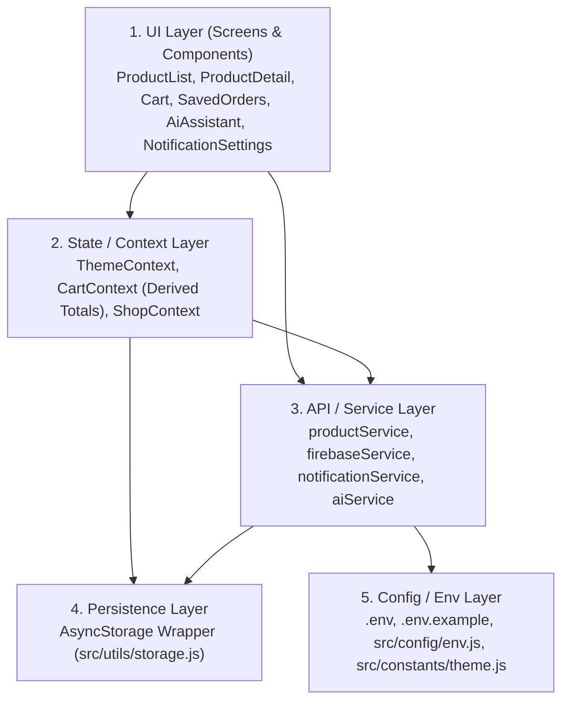

# Bảng Truy Vết Yêu Cầu (RTM), Phân Tích Bài Toán & Quyết Định Thiết Kế (DDR)

- **Sinh viên thực hiện:** Trần Võ Anh Kiệt (`CE180795`)
- **Email:** `KietTVACE180795@fpt.edu.vn`
- **Học phần:** MMA301 – Assignment 2 (Integrated E-Commerce Mobile App)

---

## 1. Requirements Traceability Matrix - RTM (Mục 2.1)

| Mã YC | Yêu cầu chức năng / kỹ thuật | Màn hình / Module | File / Hàm chính chịu trách nhiệm | Cách kiểm chứng (Test Case) | Trạng thái |
| :--- | :--- | :--- | :--- | :--- | :---: |
| **R01** | Tải danh sách sản phẩm từ Remote API; có đủ trạng thái `loading`, `empty`, `error` và `retry` | `ProductListScreen` | `src/services/productService.js` (`fetchProductsPage`, `normalizeProduct`) `src/screens/ProductListScreen.js` (`loadFirstPage`) `src/components/StateFeedback.js` | **Case 1:** Mở app khi có mạng -> Tải sản phẩm thành công. **Case 2:** Bật mô phỏng lỗi mạng -> Hiện màn hình Error + nút `Thử lại` & `Offline Fallback`. | Hoàn thành |
| **R02** | Tìm kiếm sản phẩm theo từ khóa và lọc theo danh mục; có trạng thái rỗng rõ ràng | `ProductListScreen` | `src/screens/ProductListScreen.js` (`searchText`, `selectedCategory`, `handleResetFilters`) `src/services/productService.js` | **Case 3:** Nhập từ khóa có/không có kết quả (`"xyz123"`), chọn danh mục `Laptop` -> Hiển thị đúng hoặc báo Empty + nút `Xóa bộ lọc`. | Hoàn thành |
| **R03** | Phân trang (`limit` + `skip`) hoặc infinite scroll kèm `pull-to-refresh`; chặn gọi lặp request | `ProductListScreen` | `src/screens/ProductListScreen.js` (`handleLoadMore`, `isFetchingMoreRef`, `handlePullToRefresh`) | **Case 4:** Cuộn xuống đáy danh sách -> Tải trang tiếp theo, không gọi trùng khi hết dữ liệu. **Case 5:** Kéo xuống làm mới -> Reset `skip = 0`, không nhân đôi phần tử. | Hoàn thành |
| **R04** | Xem chi tiết sản phẩm đầy đủ qua điều hướng (`route.params.product`) | `ProductDetailScreen` | `src/screens/ProductDetailScreen.js` `App.js` (`Stack.Navigator`) | Bấm vào bất kỳ thẻ `ProductCard` nào -> Mở đúng màn hình chi tiết, hiển thị ảnh, giá, tồn kho, mô tả và số lượng đang có trong giỏ. | Hoàn thành |
| **R05** | Thêm/cập nhật/xóa mặt hàng trong giỏ hàng; kiểm soát biên số lượng (`<= 0` tự xóa) | `ProductDetailScreen`, `CartScreen` | `src/context/CartContext.js` (`addToCart`, `updateQuantity`, `incrementQuantity`, `decrementQuantity`, `removeFromCart`) | **Case 6:** Thêm sản phẩm vào giỏ -> Số lượng và thành tiền tăng đúng. **Case 7:** Giảm số lượng từ 1 về 0 -> Xóa sản phẩm khỏi giỏ, không bao giờ sinh số âm. | Hoàn thành |
| **R06** | Tính tổng số lượng, tạm tính, giảm giá, phí ship và tổng thanh toán dưới dạng **Derived State** | `CartScreen`, `ProductListScreen` | `src/context/CartContext.js` (`cartSummary` tính qua `useMemo`) | Thay đổi số lượng trong giỏ -> `totalItems`, `subtotal`, `discountAmount` (-5% đơn >= $300), `shippingFee` (Freeship đơn >= $100) và `finalTotal` tự cập nhật tức thì. | Hoàn thành |
| **R07** | Lưu bền vững dữ liệu cục bộ (`AsyncStorage`) và khôi phục an toàn khi mở lại app | Toàn bộ ứng dụng | `src/utils/storage.js` (`getStoredItem`, `setStoredItem`, `STORAGE_KEYS`) `src/context/CartContext.js` `src/context/ThemeContext.js` | **Case 8:** Thêm sản phẩm vào giỏ, bật Dark Mode, đóng và mở lại ứng dụng -> Giỏ hàng và giao diện được khôi phục nguyên vẹn. | Hoàn thành |
| **R08** | Tích hợp Firebase cho nghiệp vụ thương mại điện tử (Wishlist & Lịch sử Đơn hàng) kèm xử lý lỗi | `SavedOrdersScreen`, `CartScreen`, `ProductDetailScreen` | `src/services/firebaseService.js` (`fetchFirebaseWishlist`, `saveFirebaseWishlist`, `createFirebaseOrder`) `src/context/ShopContext.js` | **Case 9:** Lưu sản phẩm yêu thích & Đặt hàng -> Đồng bộ thành công. **Case 10:** Bật mô phỏng lỗi Firebase -> Hiện cảnh báo lỗi rõ ràng, không mất dữ liệu giỏ hàng. | Hoàn thành |
| **R09** | Xử lý xin quyền và phát thông báo (`Notification`) gắn với sự kiện nghiệp vụ hợp lý | `NotificationSettingsScreen`, `CartScreen` | `src/services/notificationService.js` (`requestNotificationPermission`, `triggerBusinessNotification`) `src/components/NotificationBanner.js` | **Case 11:** Đặt quyền `Denied` -> App không crash, ghi nhật ký đã chặn. **Case 12:** Đặt quyền `Granted` & Đặt hàng / Bấm nút Test -> Hiện banner thông báo & lưu lịch sử. | Hoàn thành |
| **R10** | Tích hợp Gemini AI nhận ngữ cảnh Catalog/Giỏ hàng/Ngân sách, **validate output** và có fallback | `AiAssistantScreen` | `src/services/aiService.js` (`buildShoppingPrompt`, `validateAiOutputAgainstCatalog`, `askGeminiProductAssistant`) | **Case 13:** Gửi yêu cầu tư vấn hợp lệ -> Gợi ý đúng sản phẩm trong Catalog. **Case 14:** Mô phỏng AI trả kèm sản phẩm ảo giác `ID #99999` -> Bộ lọc tự động chặn và báo cáo. | Hoàn thành |
| **R11** | Cấu hình chuẩn bị phát hành Android Release Build (`app.json`, `eas.json`, không lộ secret) | Cấu hình dự án | `app.json`, `eas.json`, `.gitignore`, `.env.example`, `docs/RELEASE_BUILD_EVIDENCE.md` | **Case 15:** Kiểm tra cấu hình package `com.ce180795.assignment2`, `versionCode: 1`, build profile APK và không có API key trong Git. | Hoàn thành |
| **R12** | Bộ hồ sơ kỹ thuật đầy đủ (`README`, `RTM`, `DDR`, `Test Matrix`, `Debug Logs`, `AI Usage Log`) | Thư mục `docs/` & `README.md` | `README.md` và 5 file tài liệu trong `docs/` | Đối chiếu đầy đủ các mục từ Mục 2 đến Mục 12 của đề bài Assignment 2. | Hoàn thành |

---

## 2. Problem Understanding Worksheet (Mục 2.2)

### 2.1. Người dùng thực hiện những hành động chính nào trong ứng dụng?
1. Duyệt danh sách sản phẩm công nghệ từ API từ xa, kéo xuống để tải thêm trang mới (`Pagination`) hoặc vuốt xuống để làm mới (`Pull-to-refresh`).
2. Tìm kiếm sản phẩm theo tên/hãng và lọc nhanh theo danh mục (`Điện thoại`, `Laptop`, `Máy tính bảng`, `Phụ kiện`, `Đồng hồ`).
3. Xem thông tin chi tiết của một sản phẩm, chọn số lượng kèm ghi chú mua hàng để thêm vào giỏ hàng, hoặc bấm lưu vào danh sách Yêu thích (`Wishlist`).
4. Quản lý giỏ hàng (tăng/giảm số lượng, xóa món hàng, kiểm tra bảng tính tạm tính/giảm giá/phí vận chuyển) và xác nhận Đặt hàng (`Place Order`).
5. Theo dõi các sản phẩm đã lưu (`Wishlist`) và lịch sử các đơn hàng đã đặt (`Order History`) được đồng bộ qua dịch vụ Firebase.
6. Nhờ Trợ lý Gemini AI gợi ý hoặc so sánh sản phẩm dựa trên nhu cầu sử dụng, ngân sách tối đa và dữ liệu Catalog hiện có.
7. Cấu hình quyền nhận thông báo (`Granted` / `Denied`), chuyển đổi giao diện Sáng/Tối (`Dark Mode`), và kiểm tra nhật ký thông báo hệ thống.

### 2.2. Dữ liệu đầu vào (Input) của từng màn hình là gì?
- **`ProductListScreen`:** Từ khóa tìm kiếm (`searchText`), mã danh mục (`selectedCategory`), chỉ số phân trang (`limit`, `skip`), thao tác kéo làm mới.
- **`ProductDetailScreen`:** Đối tượng `product` nhận qua `route.params.product`, số lượng chọn mua (`selectedQty`), ghi chú mặt hàng (`customNote`).
- **`CartScreen`:** Danh sách `cartItems` từ `CartContext`, thao tác bấm nút `+` / `-` / `Xóa`, ghi chú giao hàng (`customerNote`).
- **`SavedOrdersScreen`:** Tab đang chọn (`wishlist` hoặc `orders`), dữ liệu đồng bộ từ `firebaseService` và thao tác bấm nút `Đồng bộ ngay` / `Bỏ lưu`.
- **`AiAssistantScreen`:** Chế độ tư vấn (`recommend` / `compare`), câu hỏi nhu cầu (`userPrompt`), ngân sách tối đa (`budgetText`), cùng ngữ cảnh nền là `knownCatalog` và `cartItems`.
- **`NotificationSettingsScreen`:** Trạng thái quyền thông báo (`granted` / `denied`), các công tắc bật/tắt thông báo theo sự kiện, công tắc Dark Mode và các công tắc mô phỏng lỗi kiểm thử.

### 2.3. Dữ liệu đầu ra (Output) hiển thị trên UI là gì?
- Danh sách thẻ sản phẩm đã chuẩn hóa, số lượng sản phẩm đang hiển thị trên tổng số (`products.length / totalCount`), và các màn hình trạng thái `Loading / Empty / Error`.
- Bảng tính tiền chi tiết trên giỏ hàng (`totalItems`, `subtotal`, `discountAmount`, `shippingFee`, `finalTotal`).
- Trạng thái đồng bộ Firebase (`syncMode`, `lastSyncedAt`), danh sách Wishlist và danh sách các đơn hàng kèm mã đơn (`ORD-xxxxxx`).
- Báo cáo kiểm증 kết quả AI (`Validation Report`: tổng số gợi ý thô, số gợi ý hợp lệ khớp Catalog, số gợi ý ảo giác đã bị chặn) và danh sách sản phẩm đề xuất.
- Thanh thông báo nổi (`NotificationBanner`) và danh sách nhật ký thông báo (`DELIVERED` hoặc `BLOCKED_PERMISSION_DENIED`).

### 2.4. Dữ liệu nào chỉ sống trong phiên làm việc (In-Memory Session State)?
- Từ khóa tìm kiếm (`searchText`), danh mục đang chọn (`selectedCategory`), vị trí phân trang (`skip`, `hasMore`), các cờ trạng thái tải (`isLoadingInitial`, `isRefreshing`, `isLoadingMore`), thông báo lỗi tạm thời (`errorMessage`), và các công tắc mô phỏng kiểm thử (`simulationFlags`).

### 2.5. Dữ liệu nào cần lưu cục bộ (`AsyncStorage`)?
- Danh sách mặt hàng trong giỏ hàng (`@mma301_a2_cart_items` - **R07**).
- Chế độ giao diện Sáng/Tối (`@mma301_a2_theme_mode`).
- Cài đặt quyền thông báo và nhật ký sự kiện thông báo (`@mma301_a2_notification_settings`, `@mma301_a2_notification_logs`).
- Bộ nhớ đệm cục bộ của Wishlist và Lịch sử Đơn hàng (`@mma301_a2_wishlist_cache`, `@mma301_a2_orders_cache`) để đảm bảo ứng dụng vẫn đọc được dữ liệu khi mất mạng.

### 2.6. Dữ liệu nào cần đồng bộ qua dịch vụ ngoài (API / Firebase / Gemini)?
- **Remote Product API (`DummyJSON`):** Danh mục sản phẩm thương mại điện tử, kết quả tìm kiếm và phân trang.
- **Firebase (`Firestore REST / Sync Service`):** Danh sách sản phẩm yêu thích (`mma301_wishlists`) và lịch sử đơn hàng đã đặt (`mma301_orders`) gắn với mã sinh viên `CE180795`.
- **Google Gemini AI API:** Phân tích nhu cầu mua sắm, so sánh ưu/nhược điểm và đề xuất mã sản phẩm (`productId`) dựa trên ngữ cảnh Catalog thật.

### 2.7. Những chỗ nào có thể lỗi: mạng, rỗng, hết trang, lưu trữ lỗi, quyền bị từ chối, AI trả dữ liệu sai?
1. **Lỗi mạng / Máy chủ API lỗi (`R01`):** Khi gọi `fetchProductsPage` không thành công -> Đã xử lý bằng `try/catch`, hiển thị component `StateFeedback (type="error")` kèm nút `Thử lại (Retry API)` và nút `Dùng dữ liệu Offline dự phòng`.
2. **Dữ liệu rỗng (`R02`):** Khi tìm kiếm từ khóa không khớp sản phẩm nào -> Hiển thị trạng thái Empty rõ ràng kèm nút `Xóa bộ lọc tìm kiếm`.
3. **Cuộn chạm đáy nhiều lần / Hết trang (`R03`):** Người dùng vuốt nhanh gây gọi lặp API -> Đã chặn bằng khóa đồng bộ `isFetchingMoreRef.current` kết hợp kiểm tra `!hasMore` và lọc trùng `id` bằng `Set`.
4. **Dữ liệu `AsyncStorage` bị hỏng JSON (`R07`):** Hàm `getStoredItem` bọc `JSON.parse` trong `try/catch`, tự động trả về `fallbackValue` an toàn thay vì làm crash ứng dụng.
5. **Lỗi kết nối Firebase (`R08`):** Khi lưu Wishlist hoặc Đặt hàng bị lỗi mạng -> Giữ nguyên dữ liệu trong giỏ hàng/bộ nhớ cục bộ và hiển thị banner cảnh báo lỗi rõ ràng trên UI.
6. **Quyền thông báo bị từ chối (`R09`):** Khi `permissionStatus === 'denied'`, hàm `triggerBusinessNotification` không gọi thông báo hệ thống, không crash app, mà trả về trạng thái `BLOCKED_PERMISSION_DENIED` và ghi nhận vào nhật ký để người dùng biết lý do.
7. **Gemini AI trả về sai định dạng hoặc bịa sản phẩm không có thật (`R10`):** Hàm `validateAiOutputAgainstCatalog()` đối chiếu từng `productId` và `productTitle` với mảng `catalogProducts` thật; mọi sản phẩm không tồn tại trong Catalog đều bị loại khỏi danh sách hiển thị và đưa vào mục `rejectedItems`.

---

## 3. Thiết Kế Giải Pháp & Lý Giải Kỹ Thuật (Mục 3)

### 3.1. Separation of Concerns (Phân tách trách nhiệm 5 tầng)

- **UI Layer (`src/screens/`, `src/components/`):** Chỉ chịu trách nhiệm hiển thị dữ liệu, nhận tương tác người dùng và phản ánh các trạng thái `loading / empty / error / success`. Không viết logic nối chuỗi URL API hay xử lý lưu trữ trực tiếp trong JSX.
- **State / Context Layer (`src/context/`):** Quản lý trạng thái dùng chung giữa nhiều màn hình (`CartContext`, `ShopContext`, `ThemeContext`) và tính toán dữ liệu dẫn xuất (`cartSummary`).
- **API / Service Layer (`src/services/`):** Chứa toàn bộ logic giao tiếp với dịch vụ bên ngoài (`productService.js`, `firebaseService.js`, `notificationService.js`, `aiService.js`), chuẩn hóa dữ liệu đầu vào/đầu ra và kiểm증 kết quả AI.
- **Persistence Layer (`src/utils/storage.js`):** Đóng gói các thao tác `AsyncStorage.getItem / setItem / removeItem` kèm xử lý ngoại lệ tập trung.
- **Config / Env Layer (`src/config/env.js`, `src/constants/theme.js`):** Quản lý biến môi trường `EXPO_PUBLIC_*`, cấu hình nghiệp vụ (`PAGE_LIMIT`, ngưỡng freeship/giảm giá) và bảng màu giao diện.

---

### 3.2. State Ownership Map (Bản đồ quyền sở hữu State)

| State / Dữ liệu | Nơi giữ State (Owner) | Nguồn dữ liệu (Source of Truth) | Màn hình sử dụng (Consumers) | Có lưu bền vững không? |
| :--- | :--- | :--- | :--- | :--- |
| **Product List & Pagination (`products`, `skip`, `hasMore`)** | `ProductListScreen` (đồng bộ sang `ShopContext.knownCatalog`) | Remote API (`DummyJSON`) + `FALLBACK_PRODUCTS` | `ProductListScreen`, `AiAssistantScreen` | Không (Tải mới từ API mỗi phiên, có fallback offline) |
| **Search & Category Filter (`searchText`, `selectedCategory`)** | `ProductListScreen` (Local UI State) | Người dùng nhập / chọn chip danh mục | `ProductListScreen` | Không (Reset khi mở lại app) |
| **Cart Items (`cartItems`: `product`, `quantity`, `note`)** | `CartContext` (`src/context/CartContext.js`) | Người dùng thêm/sửa + khôi phục từ `AsyncStorage` | `ProductListScreen`, `ProductDetailScreen`, `CartScreen`, `AiAssistantScreen` | **Có** (`AsyncStorage` key `@mma301_a2_cart_items`) |
| **Derived Cart Totals (`totalItems`, `subtotal`, `discountAmount`, `shippingFee`, `finalTotal`)** | `CartContext` (Tính động bằng `useMemo`, **không lưu vào `useState`**) | Tính trực tiếp từ mảng `cartItems` | `ProductListScreen` (badge), `CartScreen` | **Không lưu riêng** (Tự động tính lại khi `cartItems` được khôi phục) |
| **Firebase Business State (`wishlist`, `orders`, `firebaseSyncInfo`)** | `ShopContext` (`src/context/ShopContext.js`) | Firebase Firestore (`mma301_wishlists`, `mma301_orders`) + Local Cache | `ProductListScreen`, `ProductDetailScreen`, `CartScreen`, `SavedOrdersScreen` | **Có** (Đồng bộ Firebase + Cache `AsyncStorage`) |
| **Notification State (`notificationSettings`, `notificationLogs`, `inAppBanner`)** | `ShopContext` (`src/context/ShopContext.js`) | OS Permission + `notificationService.js` | `NotificationBanner`, `CartScreen`, `NotificationSettingsScreen` | **Có** (`AsyncStorage` keys `@mma301_a2_notification_*`) |
| **AI Recommendation State (`aiResult`, `validationReport`)** | `AiAssistantScreen` (Local State) | `aiService.js` (`askGeminiProductAssistant` + `validateAiOutputAgainstCatalog`) | `AiAssistantScreen` | Không (Tính theo từng truy vấn tư vấn/so sánh) |

---

### 3.3. Integration Map (Bản đồ tích hợp dịch vụ)

| Dịch vụ tích hợp | Mục đích nghiệp vụ trong ứng dụng | File cấu hình / Service chính | Input truyền vào | Output trả ra | Xử lý lỗi / Fallback khi sự cố |
| :--- | :--- | :--- | :--- | :--- | :--- |
| **Remote Product API (`DummyJSON`)** | Tải danh mục sản phẩm, tìm kiếm theo từ khóa, lọc theo danh mục và phân trang | `src/config/env.js` `src/services/productService.js` | `limit`, `skip`, `searchQuery`, `category` | `{ products, total, skip, limit, hasMore, source }` | Bắt lỗi HTTP/Network, hiện UI Error kèm nút `Thử lại` và nút chuyển sang `FALLBACK_PRODUCTS` (Offline Mode). |
| **AsyncStorage** | Lưu giỏ hàng, chế độ Sáng/Tối, cài đặt thông báo và cache dữ liệu Firebase | `src/utils/storage.js` | `key` (`STORAGE_KEYS`), `value` (Object/Array) | Dữ liệu đã parse JSON hoặc `fallbackValue` | Bọc `try/catch` quanh `JSON.parse` và `AsyncStorage`; nếu dữ liệu hỏng sẽ trả về giá trị mặc định, không crash app. |
| **Firebase (`Firestore REST / Sync`)** | Lưu trữ và đồng bộ danh sách Yêu thích (`Wishlist`) & Lịch sử Đơn hàng (`Order History`) | `src/config/env.js` `src/services/firebaseService.js` | `studentId` (`CE180795`), mảng `wishlistItems` hoặc đối tượng `orderData` | Danh sách `items` / `orders`, `syncMode`, `lastSyncedAt` | Luôn lưu bản sao vào `AsyncStorage` trước; nếu lỗi mạng hoặc chưa cấu hình cloud key sẽ dùng `Local Sync Adapter` và báo trạng thái rõ ràng. |
| **Notification (`expo-notifications`)** | Xin quyền và phát thông báo khi Đặt hàng thành công, Lưu Wishlist hoặc bấm Test | `src/services/notificationService.js` `src/components/NotificationBanner.js` | `{ title, body, eventType }` và `permissionStatus` | `{ sent, permissionStatus, record, logs }` | Nếu quyền là `denied` (Case 11) hoặc chạy trên môi trường không hỗ trợ native push, không crash app mà ghi log `BLOCKED_PERMISSION_DENIED` và báo lý do. |
| **Gemini AI (`gemini-2.5-flash`)** | Tư vấn chọn mua và so sánh sản phẩm theo nhu cầu, ngân sách và giỏ hàng | `src/config/env.js` `src/services/aiService.js` | `userPrompt`, `budgetLimit`, `catalogProducts`, `cartItems`, `mode` | `{ summary, comparisonNote, validRecommendations, rejectedItems, validationReport }` | Kiểm증 bằng `validateAiOutputAgainstCatalog()` để loại bỏ ID ảo giác; nếu thiếu API key hoặc mất mạng sẽ chuyển sang `Catalog Context Fallback Engine`. |

---

### 3.4. Design Decision Record - DDR (Mục 3.4 - 7 Quyết định Thiết kế)

| # | Quyết định thiết kế | Phương án chọn | Lý do chọn | Phương án không chọn | Trade-off / Rủi ro |
| :-: | :--- | :--- | :--- | :--- | :--- |
| **1** | **Quản lý State toàn cục (State Management)** | Sử dụng **React Context API** tách thành 3 Context chuyên biệt (`ThemeContext`, `CartContext`, `ShopContext`) kết hợp `useState` / `useMemo`. | Phù hợp với quy mô ứng dụng 6 màn hình, sẵn có trong React, code tường minh, dễ giải thích từng dòng khi bảo vệ và không làm phình kích thước bundle. | Redux Toolkit hoặc Zustand. | Khi số lượng màn hình tăng lên hàng chục, Context có thể gây re-render rộng hơn nếu không tách nhỏ Context như hiện tại. |
| **2** | **Tính toán Tổng tiền Giỏ hàng (Cart Totals - R06)** | Tính toán dưới dạng **Derived State** bằng hook `useMemo` (`cartSummary`) trực tiếp từ mảng `cartItems`. | Đảm bảo **Single Source of Truth**: mọi thao tác thêm, tăng, giảm, xóa sản phẩm chỉ cần cập nhật `cartItems`, tổng tiền luôn chính xác 100%, không bao giờ bị lệch state. | Tạo các `useState` riêng cho `subtotal`, `totalItems`, `finalTotal` rồi cập nhật thủ công ở từng hàm. | Hàm `reduce` trong `useMemo` chạy lại mỗi khi `cartItems` thay đổi, nhưng với giỏ hàng dưới vài trăm món thì thời gian tính chưa tới 1ms. |
| **3** | **Cấu trúc API & Service Layer** | Tách 4 module độc lập trong `src/services/` (`productService`, `firebaseService`, `notificationService`, `aiService`) kèm hàm chuẩn hóa `normalizeProduct()`. | Tuân thủ đúng nguyên tắc **Separation of Concerns**: màn hình UI không cần biết chi tiết URL hay cấu trúc JSON thô của server, dễ dàng gắn thêm cờ mô phỏng lỗi để kiểm thử. | Gọi `fetch()` trực tiếp bên trong `useEffect` của từng màn hình. | Phải viết thêm các hàm trung gian và định nghĩa rõ kiểu dữ liệu trả về giữa Service và Screen. |
| **4** | **Chiến lược Phân trang & Chống gọi lặp (Pagination - R03)** | Phân trang theo `limit=8` & `skip` kết hợp khóa đồng bộ `useRef` (`isFetchingMoreRef`) và lọc trùng `id` bằng `Set`. | `useRef` đổi giá trị tức thì trong cùng chu kỳ render, chặn triệt để hiện tượng `FlatList.onEndReached` bắn 2–3 lần liên tiếp khi người dùng cuộn nhanh chạm đáy. | Chỉ dùng biến state `isLoadingMore` để chặn trong `onEndReached`. | Cần nhớ reset `isFetchingMoreRef.current = false` trong khối `finally` để không khóa nhầm các lần tải hợp lệ tiếp theo. |
| **5** | **Lưu trữ Cục bộ (`AsyncStorage` - R07)** | Xây dựng wrapper `getStoredItem` / `setStoredItem` trong `src/utils/storage.js` có `try/catch` và `fallbackValue` mặc định. | Bảo vệ ứng dụng không bao giờ bị crash khi lần đầu mở app (dữ liệu `null`) hoặc khi chuỗi JSON trong bộ nhớ bị lỗi (corrupted data). | Gọi `JSON.parse(await AsyncStorage.getItem(...))` trực tiếp ở từng màn hình. | Khi có lỗi ghi bộ nhớ đầy, wrapper trả về `false` và log cảnh báo chứ không làm gián đoạn luồng giao diện của người dùng. |
| **6** | **Nghiệp vụ Firebase & Cơ chế Offline-Safe (R08)** | Kết hợp đồng bộ **Firebase Firestore REST API** cho 2 nghiệp vụ `Wishlist` + `Order History` kèm bộ đệm `Local Sync Adapter` trên `AsyncStorage`. | Giúp ứng dụng hoạt động bền bỉ cả khi có cấu hình Firebase Cloud lẫn khi chạy demo ở phòng thi mất mạng hoặc trên máy ảo chưa đăng nhập Google Play Services. | Chỉ dùng SDK Firebase thuần không có bộ nhớ đệm local fallback. | Cần quản lý trạng thái đồng bộ (`syncMode`, `lastSyncedAt`, `error`) rõ ràng trên UI để người dùng phân biệt dữ liệu Cloud và Cache. |
| **7** | **Ngữ cảnh & Kiểm증 Kết quả Gemini AI (R10)** | Truyền danh sách `catalogProducts` thật vào prompt yêu cầu trả JSON có `productId`, sau đó bắt buộc lọc qua hàm `validateAiOutputAgainstCatalog()`. | Ngăn chặn triệt để rủi ro AI "ảo giác" (Hallucination) bịa ra sản phẩm không tồn tại trong cửa hàng; chỉ những sản phẩm khớp ID/tên với Catalog thật mới được hiển thị nút mua. | Hiển thị trực tiếp đoạn văn bản tự do do Gemini sinh ra lên màn hình. | Nếu AI gợi ý toàn sản phẩm ngoài danh mục thì danh sách hợp lệ sẽ rỗng, do đó cần có thêm `Catalog Context Fallback Engine` để luôn mang lại gợi ý hữu ích. |

